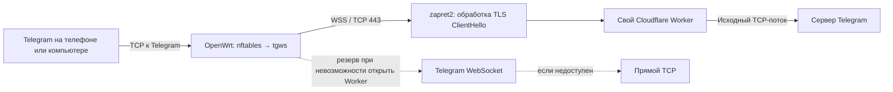

# Telegram на OpenWrt: результаты настройки и диагностики

На Xiaomi AX3000T удалось добиться быстрой отправки голосовых и кружков с iPhone
без VPN и без прокси в приложении Telegram. Рабочая комбинация в проверенной сети:
**tgws 0.1.5 → Cloudflare Worker, а доступ к Worker — с TLS-стратегией zapret2**.

Это отчёт об одном домашнем подключении, а не обещание работы у любого провайдера.
Последняя проверка — 7 ноября 2026 года. Короткий успешный тест не заменяет
наблюдение за стабильностью в течение нескольких дней.

[Установка пакетов](README.md#быстрый-старт) · [Создание своего Worker](worker/README.ru.md) ·
[Релиз 0.1.5](https://github.com/trikesh32/tgws-openwrt/releases/tag/v0.1.5)

## Рабочая схема



zapret2 здесь обрабатывает пакеты на роутере; это не отдельный сервер и не туннель.
Worker открывает TCP-соединение к исходному адресу и порту Telegram. В этом режиме
tgws не переупаковывает MTProto: передаёт исходные байты через WebSocket.
Для резервного Telegram WebSocket остаётся отдельная логика преобразования транспорта.

Cloudflare завершает внешний TLS и видит сетевые метаданные, но содержимое Telegram
остаётся зашифрованным протоколом Telegram. Схема не добавляет сквозное шифрование
обычным облачным чатам и не заменяет свойства безопасности самого Telegram.

## Что проверено

| Компонент | Конфигурация / результат |
|---|---|
| Роутер | Xiaomi AX3000T, OpenWrt 25.12.6, `aarch64_cortex-a53` |
| Пакеты | `tgws` и `luci-app-tgws` 0.1.5-r1, русский интерфейс LuCI |
| Telegram | iPhone: сообщения, голосовые, кружки и загрузка медиа; Windows: загрузка чатов |
| Основной маршрут | Собственный Worker, `worker_mode=prefer` |
| Резерв | Telegram WebSocket, затем прямой TCP, если открытие предыдущего пути не удалось |
| TLS | `hostfakesplit` для `web.telegram.org` и точного домена своего Worker |
| YouTube / Discord | Ранее подтверждена работа YouTube, Discord и голоса Discord с адаптацией ALT12; при добавлении Telegram остальные профили сохранены |
| Звонки Telegram | Не исправлены; этот Worker переносит TCP, а не UDP |

Точный исходный код приложения, проверенного на роутере:
[`e6695ce`](https://github.com/trikesh32/tgws-openwrt/commit/e6695ce3c969dabb6fdd0856eccd2e07daaa5954).
Публикация отчёта и исправления документации идут следующими коммитами.

## Как пришли к результату

| Опыт | Наблюдение |
|---|---|
| Telegram WebSocket без отдельной TLS-стратегии | Чаты работали, медиа периодически зависали; встречались таймауты соединений |
| Worker как основной путь без TLS-стратегии | Чаты сначала стали медленнее; отдельная повторная проверка на iPhone также дала зависания |
| Worker как резерв | Чаты вернулись к прежнему состоянию, медиа существенно не улучшились |
| 0.1.5: исправление выбора прямого отката и добавление DC203 | Исправлена обнаруженная проблема в коде, но зависания на iPhone остались |
| Мобильная сеть без VPN | Голосовое тоже зависало |
| Мобильная сеть с рабочим VPN | Новое голосовое отправилось быстро |
| Telegram WebSocket + TLS-стратегия | Пользователь отметил заметное улучшение, но обрывы сохранились |
| Worker + та же TLS-стратегия | В отдельной проверке на iPhone: быстро, без замеченных обрывов |

После последнего теста Worker выбран основным для всей домашней сети.
В интервале оставшихся проблем с обычным Telegram WebSocket счётчики всей сети
показали ещё 5 ошибок открытия WebSocket и 2 первых ответа с кодом `-404`.
Это не доказывает причину каждого зависания на конкретном устройстве.

Отдельно проверяли обход очереди zapret для синтетических подключений к одному
Telegram endpoint: обычный путь — 3 успеха из 8, обход очереди — 5 из 8.
Таймауты были в обеих группах. Выборка мала, а TLS-стратегия для Telegram тогда ещё
не применялась: этот опыт не сравнивает рабочий `hostfakesplit` с его отключением.

Три UDP-стратегии для звонков (два профиля и фрагментация первых пакетов) не убрали
зависание на обмене ключами/соединении. Поддержка UDP через этот Worker не реализована.

## Числа последней успешной проверки

Отдельный экземпляр tgws принимал только трафик тестового iPhone в течение 150 секунд.
Итоговые счётчики из локального журнала, без адресов клиента и токенов:

| Метрика | Значение |
|---|---:|
| Соединения через Worker | 92 |
| Ошибки открытия Worker | 0 |
| Отклонения по лимиту соединений | 0 |
| Байты от клиента | 776 321 |
| Байты к клиенту | 6 986 434 |

Машиночитаемая копия: [results/iphone-worker-tls.json](results/iphone-worker-tls.json).
Это объём трафика за окно наблюдения, **не замер максимальной скорости**.
`worker_errors=0` означает отсутствие зарегистрированных ошибок открытия пути;
счётчик не подтверждает завершение каждого файла. Результат отправки дополнительно
подтвердил пользователь. После перевода всей сети на Worker были отдельные
`admission_drops`: успешная проверка одного телефона не исключает достижения
лимита при одновременных переподключениях других устройств.

## Как повторить

### 1. Установить tgws и создать свой Worker

Используйте [быстрый старт](README.md#быстрый-старт), затем
[инструкцию Worker](worker/README.ru.md). Нужен собственный аккаунт Cloudflare,
собственный Worker и случайный `TGWS_TOKEN`. Секрет вводится в Cloudflare и LuCI.
Домен и токен автора не нужны и не публикуются в этом отчёте.

В LuCI укажите домен Worker и выберите режим **предпочитать Worker для всех
TCP-соединений Telegram** (`prefer`). Это режим успешного опыта, а не новое
значение по умолчанию пакета: по умолчанию остаётся `fallback`.

У использованного роутера таблица резервных WebSocket-целей была такой:

```text
2:149.154.167.220,4:149.154.167.220,203:149.154.167.220
```

Это публичный адрес Telegram, проверенный в конкретный день. Он может перестать
подходить в другой сети. Для самого Worker таблица `dc_ip` не используется.

### 2. Добавить домены в подходящий профиль zapret2

Этот шаг рассчитан на **уже установленный и работающий zapret2** с Lua-функцией
`hostfakesplit`. Пакет tgws не устанавливает zapret2 и не меняет его конфигурацию.
Пример не является готовой конфигурацией для zapret первого поколения или bat-файла Windows.

Создайте `/opt/zapret2/ipset/telegram-tls.txt` с двумя строками, заменив пример
на точный домен своего Worker:

```text
web.telegram.org
tgws-relay.example.workers.dev
```

В проверенной конфигурации к **существующему** профилю TCP/443 с `hostfakesplit`
добавили второй аргумент hostlist:

```text
--hostlist=/opt/zapret2/ipset/telegram-tls.txt
```

Полный фрагмент этого профиля после изменения:

```text
--new --filter-tcp=443
--hostlist=/opt/zapret2/ipset/youtube.txt
--hostlist=/opt/zapret2/ipset/telegram-tls.txt
--payload=tls_client_hello
--lua-desync=hostfakesplit:host=www.google.com:tcp_ts=-600000:tcp_ts_up:ip_id=zero
```

Это аргументы nfqws2 внутри `/opt/zapret2/config`, **не команды shell**.
Не заменяйте ими весь конфиг. Сохраните кавычки и формат существующего параметра
`NFQWS2_OPT`, порядок профилей и остальные правила YouTube/Discord. Если раньше
есть профиль, который уже забирает этот трафик, простое добавление в конец может
не дать нужного результата. Очередь zapret должна обрабатывать исходящие
TCP/443-соединения самого роутера: WebSocket открывает демон tgws.

В нашем случае конфигурация проверена `nfqws2 --dry-run` с полным набором аргументов
и используемых Lua-модулей, затем перезапущена служба `/etc/init.d/zapret2 restart`.
Список YouTube оставлен исходным, домены Telegram вынесены в отдельный файл.
Описание стратегии: [официальное руководство zapret2](https://github.com/bol-van/zapret2/blob/master/docs/manual.md#hostfakesplit).

### 3. Проверить реальные передачи

Отключите VPN и прокси Telegram на тестовом устройстве, подключитесь к домашнему
Wi-Fi и полностью перезапустите приложение. Отправьте новое голосовое или кружок
в «Избранное», загрузите несколько ещё не закэшированных фото и видео.
Проверка короткого запроса в LuCI полезна, но не заменяет этот опыт.

Состояние можно прочитать по SSH на роутере:

```sh
ubus call luci.tgws status
cat /var/run/tgws/stats.json
```

Сравнивайте счётчики до и после одного действия. При перезапуске демона они
сбрасываются. `worker` показывает число соединений, а не число отправленных файлов;
`bytes_up`/`bytes_down` общие для Worker и обычного WebSocket, без прямого TCP.
`first_reply_404/429/444` относятся только к обычному Telegram WebSocket.
`admission_drops` означает достижение лимита 64 соединения на демон или 16 на IP.
Не публикуйте целиком UCI-конфиг, runtime-файл токена, DHCP leases и необработанные логи.

Для сравнения с прежним поведением переключите Worker обратно на `fallback`;
пустой домен полностью отключает Worker. Уже открытое соединение между маршрутами
не переносится: для повторного теста требуется новое соединение Telegram.

## Почему комбинация могла помочь

Наиболее правдоподобное объяснение — фильтрация или деградация соединений на пути
от домашней сети. `hostfakesplit` меняет представление TLS ClientHello в TCP-пакетах,
которое видит сетевой фильтр; Worker меняет дальнейший маршрут до Telegram.
Это согласуется с результатами, но конкретный механизм фильтрации не установлен.
Не измерены порог ограничения в байтах, длительная скорость и суточная стабильность.
Отдельного строгого рандомизированного теста конечной комбинации не было.

## Ограничения и стоимость

- Перехватывается IPv4 TCP к подсетям Telegram на портах 80, 443 и 5222.
  IPv6 и UDP этим маршрутом не переносятся. Это не универсальный VPN.
- Звонки Telegram остались нерешённой задачей. Работоспособность Discord voice
  с ALT12 не означает работоспособность Telegram calls.
- При ошибке до передачи данных возможен выбор другого пути. После начала
  передачи автоматического переноса существующей сессии нет.
- Лимиты нашего кода: 64 соединения на демон, 16 на IP; Worker принимает кадры
  до 256 КиБ, очередь записей до 1 МиБ и закрывает соединение после 5 минут простоя.
  Это не максимальный размер файла: поток передаётся частями.
- На Workers Free: 100 000 запросов в сутки на аккаунт, сброс в 00:00 UTC;
  открытие WebSocket считается запросом, сообщения внутри него — нет.
  Лимит CPU — 10 мс на вызов, память среды — 128 МБ. Ожидание сети не расходует CPU.
  Фиксированная квота в гигабайтах в тарифе Workers не указана, скорость не гарантирована.
  Проверено по документации 7 ноября 2026 года:
  [лимиты](https://developers.cloudflare.com/workers/platform/limits/),
  [тарификация](https://developers.cloudflare.com/workers/platform/pricing/).

## Что вошло в форк

- Отдельные пакеты демона, LuCI и перевода; установка через `apk` с SHA-256 манифестом.
- Обязательная изоляция службы, непривилегированный пользователь, лимиты ресурсов,
  проверка размеров MTProto и WebSocket handshake.
- Авторизованный Worker с ограничением адресов только подсетями Telegram,
  сохранением исходного TCP-порта и последовательной записью потока.
- Настройки и проверка Worker через LuCI, режимы `fallback` и `prefer`.
- В 0.1.5: временная пауза Telegram WebSocket ведёт на прямой TCP только после
  недавнего ответа с того же IP и порта; отсутствие ошибки больше не считается
  доказательством работоспособности прямого пути. Добавлены счётчики ошибок транспорта.

Проверки кода: `go test -race ./...`, `go vet ./...`, `sh tests/run.sh`, тесты Worker;
CI дополнительно проверяет LuCI, ucode и кросс-сборку. Пакеты собираются в SDK
OpenWrt. Результаты запусков доступны во вкладке
[Actions](https://github.com/trikesh32/tgws-openwrt/actions).

В репозитории опубликованы исходники, инструкции и обезличенные итоговые счётчики.
Сырые домашние логи, захваты трафика, токены, адрес Worker автора и сетевые идентификаторы
устройств в отчёт не включены.

Основа — [NooBiToo/tgws-openwrt](https://github.com/NooBiToo/tgws-openwrt),
идея транспорта — [Flowseal/tg-ws-proxy](https://github.com/Flowseal/tg-ws-proxy),
TLS-стратегия — [bol-van/zapret2](https://github.com/bol-van/zapret2).
